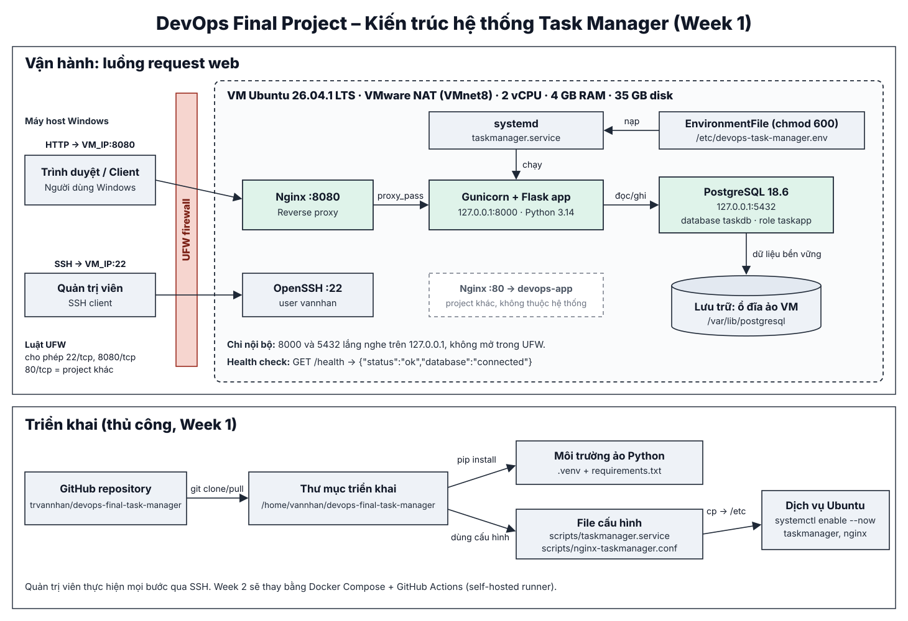

# DevOps Final Project 2026 — Task Manager (Week 1)

**Nhóm:** Nhân · Long · Lực  
**Giai đoạn:** Week 1 — Infrastructure Setup & Initial Deployment (2.0/10 điểm).  
**Repository:** https://github.com/trvannhan/devops-final-task-manager

Ứng dụng quản lý công việc với giao diện web và REST API, xây dựng bằng **Flask**, lưu dữ liệu thật vào **PostgreSQL**. Trọng tâm của Week 1 là triển khai **thủ công** trên Ubuntu VMware, cấu hình mạng và chứng minh được thao tác đọc/ghi từ máy Windows. Docker và CI/CD thuộc Week 2, **chưa triển khai**.

## Chức năng và API

- Thêm, xem, đánh dấu hoàn thành/mở lại và xóa công việc; xem thống kê.
- `GET /`: giao diện; `GET /health`: tình trạng app/database.
- `GET /api/tasks`: danh sách; `POST /api/tasks`: thêm.
- `PATCH /api/tasks/<id>`: cập nhật; `DELETE /api/tasks/<id>`: xóa.
- Dữ liệu lưu trong database `taskdb`, bảng `tasks`, **không lưu bằng localStorage**.

## Kiến trúc triển khai thực tế



[Xem diễn giải architecture](docs/architecture.md) · [Thông tin server và kiểm tra](docs/server-configuration.md) · [Danh sách minh chứng](evidence/README.md)

**Luồng:** Windows Client → mạng VMware (NAT) → Ubuntu Nginx `:8080` → Gunicorn/Flask `127.0.0.1:8000` → PostgreSQL `127.0.0.1:5432` → virtual disk. `systemd` quản lý `taskmanager.service`; UFW lọc inbound. Bài DevOps Challenge 1 cũ vẫn ở Nginx `:80` → Flask `:5000` và **không bị thay thế**.

> `192.168.79.129` là địa chỉ máy ảo tại thời điểm demo ngày 21/10/2026 (mạng NAT), không phải địa chỉ cố định hoặc địa chỉ Internet công cộng. Dùng `hostname -I` để lấy IP hiện hành.

## Môi trường ghi nhận ngày 21/10/2026

| Thành phần | Giá trị thực tế |
|---|---|
| Hypervisor / OS | VMware Workstation / Ubuntu 26.04.1 LTS |
| Tài khoản Linux | `vannhan` |
| CPU / RAM / swap | 2 vCPU / 3.3 GiB / 3.8 GiB |
| Disk | 35 GiB; root `/dev/sda2`; đã dùng 11 GiB (33%), còn 22 GiB |
| Database | PostgreSQL 18.6, port 5432 (loopback) |
| Application | Flask 3.1.3 qua Gunicorn; service `taskmanager` |
| Reverse proxy | Nginx: Task Manager `:8080`; ứng dụng cũ `:80` |
| Firewall | UFW active; inbound deny mặc định; allow 22, 80, 8080 TCP |

## Quy trình cài đặt thủ công trên Ubuntu (Week 1)

### 1. Chuẩn bị server

Trên Ubuntu VM, với tài khoản có quyền `sudo`:

```bash
sudo apt update
sudo apt install -y git python3 python3-venv python3-pip postgresql postgresql-contrib nginx curl ufw
sudo systemctl enable --now nginx postgresql
```

### 2. PostgreSQL — user riêng, database riêng

```bash
sudo -u postgres psql
```

Trong `psql` (thay mật khẩu mẫu bằng mật khẩu riêng mạnh):

```sql
CREATE USER taskapp WITH PASSWORD 'REPLACE_WITH_STRONG_PRIVATE_PASSWORD';
CREATE DATABASE taskdb OWNER taskapp;
\q
```

`schema.sql` tạo bảng nếu chưa có. **Chạy schema từ repository trước khi sử dụng ứng dụng trên môi trường mới**:

```bash
cd ~/devops-final-task-manager
psql -h 127.0.0.1 -U taskapp -d taskdb -f schema.sql
```

**Lưu ý:** môi trường demo của nhóm đã tạo bảng thủ công trước khi clone repo. Bảng đang chạy có `id SERIAL`, `title VARCHAR(255)`, `description TEXT`, `created_at TIMESTAMP`; file `schema.sql` dùng `BIGSERIAL`, `VARCHAR(200)`, `VARCHAR(1000)`, `TIMESTAMPTZ`. Hai cấu trúc cùng hỗ trợ các thao tác hiện tại, nhưng **không giống hoàn toàn**. Không sửa bảng production/demo chỉ để khớp ví dụ; khi chuyển Week 2 nên chuẩn hóa schema và migration.

### 3. Clone source và dependencies

```bash
cd ~
git clone https://github.com/trvannhan/devops-final-task-manager.git
cd devops-final-task-manager
python3 -m venv .venv
.venv/bin/python -m pip install -r requirements.txt
.venv/bin/python -m pytest -q
```

Trường hợp clone đã tồn tại: `cd ~/devops-final-task-manager && git pull --ff-only origin main`. Trong Week 1 thao tác này là **thủ công**, không phải CI/CD.

### 4. Secrets và systemd

```bash
cd ~/devops-final-task-manager
cp .env.example .env
chmod 600 .env
nano .env
```

Điền `DATABASE_URL=postgresql://taskapp:<PASSWORD_URL_ENCODED>@127.0.0.1:5432/taskdb`. Nếu mật khẩu có ký tự đặc biệt, URL-encode phần mật khẩu; không đưa secrets lên Git.

```bash
sudo install -o vannhan -g vannhan -m 600 .env /etc/devops-task-manager.env
sudo cp scripts/taskmanager.service /etc/systemd/system/taskmanager.service
sudo systemctl daemon-reload
sudo systemctl enable --now taskmanager
sudo systemctl status taskmanager --no-pager
curl http://127.0.0.1:8000/health
```

Trên máy demo, cấu hình service dùng `User=vannhan`, `WorkingDirectory=/home/vannhan/devops-final-task-manager` và `ExecStart` Gunicorn ở loopback port 8000. Nếu triển khai user khác, sửa đường dẫn và user tương ứng. `/etc/devops-task-manager.env` chứa bí mật; **không hiển thị nội dung trong video**.

### 5. Reverse proxy, không thay thế ứng dụng bài 10%

File `scripts/nginx-taskmanager.conf` được sửa theo cổng **8080**. Đừng xóa site `devops-app` hoặc site cũ đang lắng nghe cổng 80.

```bash
sudo cp scripts/nginx-taskmanager.conf /etc/nginx/sites-available/taskmanager
sudo ln -sfn /etc/nginx/sites-available/taskmanager /etc/nginx/sites-enabled/taskmanager
sudo nginx -t
sudo systemctl reload nginx
curl http://127.0.0.1:8080/health
curl http://127.0.0.1:80/health
```

### 6. Firewall / network

Giữ console VMware khả dụng, **đảm bảo đường SSH cần thiết được cho phép trước khi enable**:

```bash
sudo ufw allow 22/tcp
sudo ufw allow 80/tcp
sudo ufw allow 8080/tcp
sudo ufw show added
sudo ufw enable
sudo ufw status verbose
hostname -I
```

Đây là cấu hình cho **lab VM**: các cổng trên được phép từ `Anywhere`; nếu triển khai ra mạng không tin cậy cần giới hạn SSH theo IP quản trị, dùng HTTPS. **Không mở** Gunicorn `:8000` hoặc PostgreSQL `:5432` ra ngoài; chúng bind loopback.

Trên Windows mở `http://<UBUNTU_IP>:8080`. Với máy demo từng dùng: `http://192.168.79.129:8080`.

## Kiểm chứng chức năng & sau reboot

```bash
systemctl is-active taskmanager
systemctl is-active nginx
pg_lsclusters
curl http://127.0.0.1:8080/health
psql -h 127.0.0.1 -U taskapp -d taskdb -c 'SELECT id,title,completed FROM tasks ORDER BY id;'
sudo ss -lntp | grep -E ':(80|5000|8000|8080|5432)\b'
```

Trên Windows: thêm task → refresh → đánh dấu hoàn thành → truy vấn SQL, chứng minh UI/API và database nhất quán. Sau khi **restart Ubuntu bằng menu Desktop**, ngày 21/10/2026 nhóm đã quan sát: `taskmanager active`, `nginx active`, PostgreSQL cluster `online`, `/health` trả `{"database":"connected","status":"ok"}`. Bằng chứng minh họa/screenshot xem [evidence checklist](evidence/README.md). Ảnh chứng minh dữ liệu sau reboot cần chụp nếu nộp tiêu chí này.

## Phân công nhóm

**Thành viên:** Nhân, Long, Lực. Bảng dưới là **đề xuất để nhóm xác nhận theo đóng góp thực tế**, chưa phải xác nhận công việc mỗi người đã hoàn thành.

| Thành viên | Đầu việc đề xuất |
|---|---|
| Nhân | Ubuntu VM, PostgreSQL, Nginx/systemd/UFW, kiểm thử triển khai |
| Long | Flask/API, CRUD, automated tests |
| Lực | Repository, tài liệu/sơ đồ, bằng chứng, demo |

Hãy sửa phân công theo công việc thực tế và bổ sung commit/screenshot người thực hiện trước khi nộp.

## Week 1 deliverables / rubric

- **Architecture (0.5):** `docs/architecture.svg` và `docs/architecture.md`.
- **Server & networking (0.5):** OS/specs, ports, UFW, SSH, service status ở `docs/server-configuration.md`.
- **App + DB (0.7):** chạy website từ Windows; thêm/đọc/cập nhật qua UI/API, đối chiếu SQL.
- **Repository/docs/roles (0.3):** GitHub history, README và phân công đã xác thực.
- **Evidence:** lưu screenshot/log dưới `evidence/week1/` theo checklist, không upload secrets.

## Lộ trình tiếp theo

- **Week 2:** Dockerfile/Compose, persistent volume, build-test-deploy pipeline và demo tự cập nhật.
- **Week 3:** metrics, dashboard, alert, log, hardening, backup/restore.
- **Week 4:** end-to-end demo, troubleshooting ≥3 tình huống, báo cáo và video.

> **Giới hạn:** Week 1 đã được kiểm tra trên VM nhóm qua ảnh kết quả, nhưng repo hiện không chứa ảnh evidence thực tế cho tất cả rubric. Các minh chứng phải được nhóm thu thập và upload, không thể thay bằng kết quả giả định.
