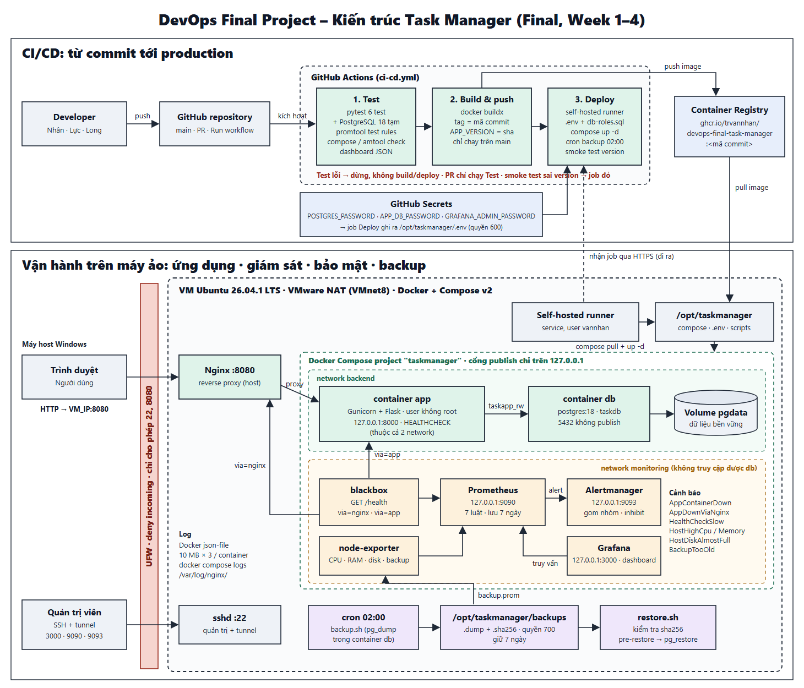
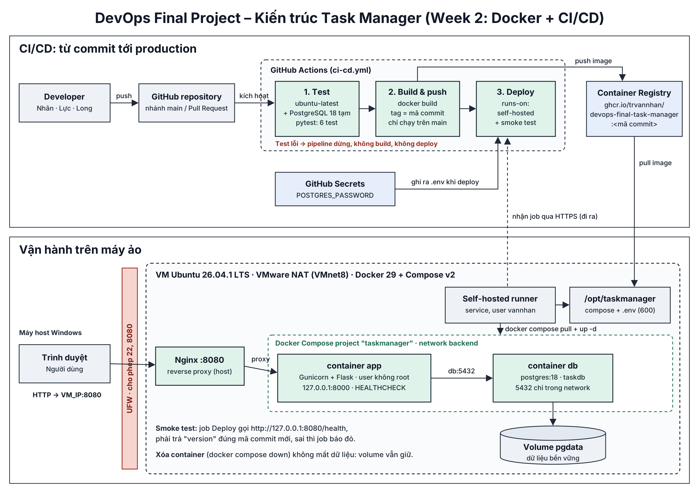
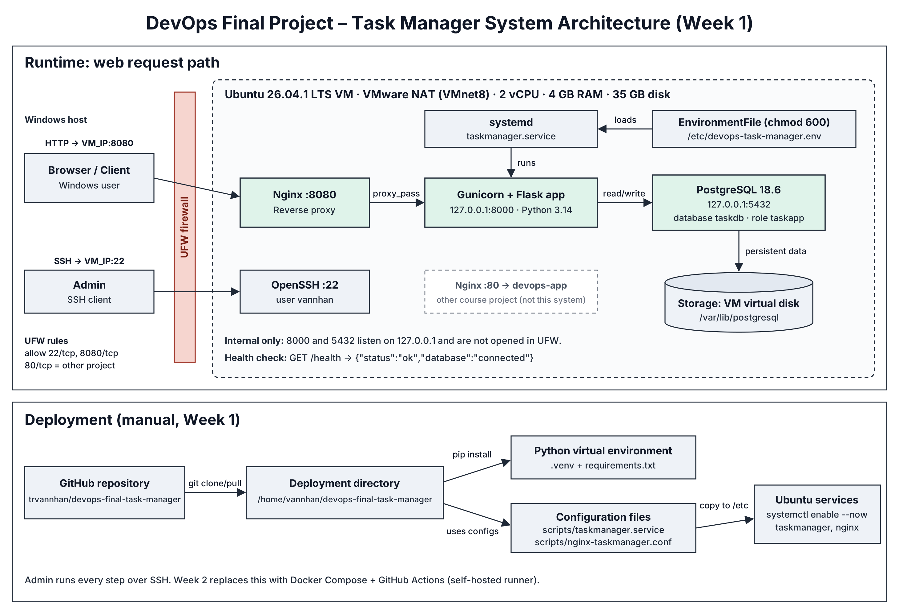

# Kiến trúc triển khai

## Final (Week 4): toàn bộ hệ thống



File nguồn: [`architecture-final.svg`](architecture-final.svg). Cách dựng lại từ máy sạch: [`deployment-guide.md`](deployment-guide.md).

| Lớp | Thành phần | Ghi chú thiết kế |
|-----|-----------|------------------|
| CI/CD | GitHub Actions: Test → Build & push (ghcr.io) → Deploy (self-hosted runner) | VM dùng NAT, không có IP public → runner trong VM tự kết nối ra GitHub, không mở thêm cổng. Smoke test so khớp `version` với mã commit |
| Truy cập | UFW (22, 8080) → Nginx `:8080` trên host → container app `127.0.0.1:8000` | Nginx giữ trên host từ Week 1 để không ảnh hưởng project khác ở cổng 80 |
| Ứng dụng | Flask + Gunicorn (user không root, HEALTHCHECK) | `/health` kiểm tra kết nối DB và trả về version |
| Dữ liệu | PostgreSQL 18, volume `pgdata`, network `backend` | Không publish 5432; app dùng role `taskapp_rw` (chỉ DML) |
| Giám sát | blackbox (2 đường: qua Nginx và thẳng app), node-exporter → Prometheus (7 luật) → Alertmanager; Grafana dashboard | Tất cả ở network `monitoring`, cổng chỉ trên 127.0.0.1, xem qua SSH tunnel. So sánh 2 đường probe để biết lỗi ở Nginx hay ở app |
| Log | Docker json-file (10 MB × 3), Nginx `/var/log/nginx/` | Tra theo thời gian bằng `docker compose logs --since/--until` |
| Backup | cron 02:00 → `backup.sh` (pg_dump, sha256, giữ 7 ngày) → `backup.prom` → cảnh báo `BackupTooOld` | `restore.sh` kiểm tra sha256, tạo bản `pre-restore` trước khi khôi phục |
| Secrets | GitHub Secrets → `.env` quyền 600 | Không có mật khẩu trong Git |

Thay đổi so với Week 2: thêm stack giám sát (5 container), network `monitoring` tách khỏi `backend`, role DB tối thiểu `taskapp_rw`, backup/restore tự động, pipeline kiểm tra cấu hình giám sát và luật cảnh báo.

## Week 2: Docker Compose + CI/CD



File nguồn: [`architecture-week2.svg`](architecture-week2.svg). Chi tiết pipeline và cách cài đặt: xem README, phần Week 2.

Thay đổi so với Week 1: app và PostgreSQL chạy trong container (Docker Compose); PostgreSQL trên VM và service `taskmanager` (systemd) đã tắt; Nginx :8080 vẫn giữ nguyên và proxy vào container app tại `127.0.0.1:8000`; deploy tự động bằng GitHub Actions qua self-hosted runner.

## Week 1: triển khai thủ công



File nguồn có thể chỉnh sửa: [`architecture.svg`](architecture.svg).

```text
Trình duyệt Windows (client, máy host)
        | HTTP :8080
        v
VM Ubuntu 26.04.1 (VMware, mạng NAT VMnet8)
  Nginx :8080 (cổng mở ra ngoài, reverse proxy)
        | proxy_pass
        v
  Gunicorn + Flask 127.0.0.1:8000   <- systemd taskmanager.service
        | psycopg (DATABASE_URL)        nạp /etc/devops-task-manager.env
        v
  PostgreSQL 18.6 127.0.0.1:5432 (database taskdb, role taskapp)
        | lưu dữ liệu bền vững
        v
  Ổ đĩa ảo Ubuntu (/var/lib/postgresql)

GitHub repository -> git clone / git pull thủ công -> /home/vannhan/devops-final-task-manager
SSH :22 (chỉ dành cho quản trị).
```

### Luồng request
1. Người dùng mở `http://VM_IP:8080` trên trình duyệt Windows.
2. UFW cho phép kết nối vào cổng 8080; Nginx nhận request.
3. Nginx chuyển tiếp (`proxy_pass`) tới Gunicorn/Flask tại `127.0.0.1:8000`.
4. Flask đọc/ghi bảng `tasks` trong PostgreSQL tại `127.0.0.1:5432`.
5. Kết quả JSON trả ngược lại qua Nginx về trình duyệt.

### Bảng cổng
| Cổng | Dịch vụ | Lắng nghe trên | Mở trong UFW |
|------|---------|----------------|--------------|
| 22   | SSH (quản trị) | mọi interface | có |
| 8080 | Nginx -> Task Manager | mọi interface | có |
| 80   | Nginx -> project khác của môn học (`devops-app`), không thuộc hệ thống này | mọi interface | có |
| 8000 | Gunicorn/Flask | chỉ 127.0.0.1 | không |
| 5432 | PostgreSQL | chỉ 127.0.0.1 | không |

Cổng 8000 và 5432 chỉ gắn với localhost, nên client chỉ có thể truy cập ứng dụng thông qua Nginx ở cổng 8080.

### Ghi chú về mạng NAT
VM dùng mạng NAT của VMware (VMnet8) nên có IP riêng trong mạng ảo. Máy Windows chạy VMware truy cập trực tiếp được vào VM. Nếu muốn máy khác trong mạng LAN truy cập, cần chuyển sang chế độ Bridged hoặc cấu hình port forwarding trong Virtual Network Editor.
