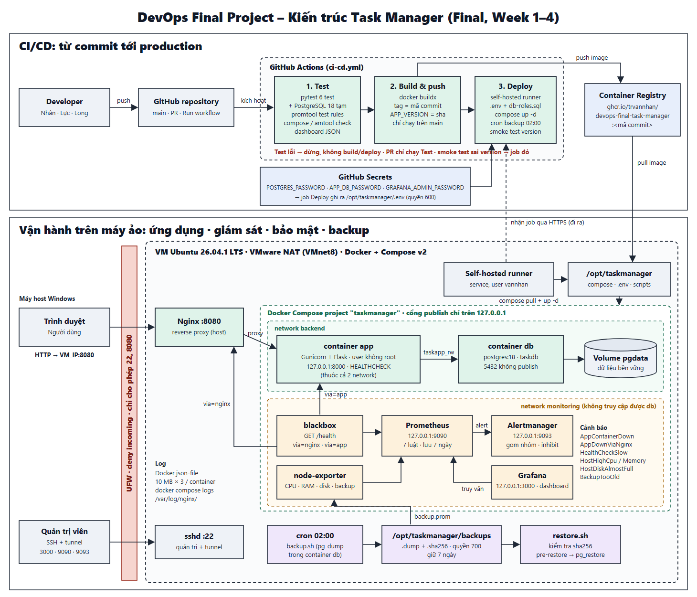
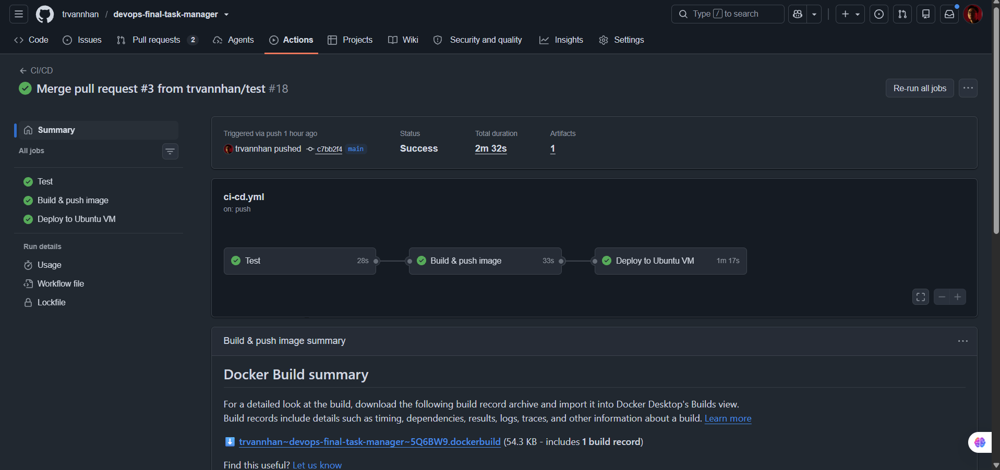

# Từ phát triển đến vận hành: Triển khai tự động và tin cậy ứng dụng Task Manager trên Ubuntu với Docker, GitHub Actions và Prometheus

**Môn học:** DevOps – Final Project 2026
**Nhóm thực hiện:** Trần Văn Nhân (23090036 – Nhóm trưởng) · Trần Văn Lực (23090019) · Nguyễn Vũ Hoàng Long (23090026)
**Repository:** https://github.com/trvannhan/devops-final-task-manager

---

## Tóm tắt (Abstract)

Báo cáo trình bày quá trình xây dựng và hoàn thiện quy trình DevOps đầu-cuối cho ứng dụng Task Manager (Flask + PostgreSQL 18) trên máy ảo Ubuntu 26.04.1 LTS trong 4 tuần. Hệ thống đi từ triển khai thủ công trên Ubuntu lên container hóa bằng Docker Compose, với Nginx trên host làm reverse proxy ở cổng 8080. Pipeline GitHub Actions 3 job (`Test` → `Build & push image` → `Deploy to Ubuntu VM`) tự động kiểm thử, đẩy image gắn tag mã commit lên `ghcr.io` và triển khai qua self-hosted runner trong mạng NAT; mỗi lần triển khai được xác minh bằng smoke test đối chiếu phiên bản trên `/health`.

Prometheus, Grafana và Alertmanager giám sát tài nguyên VM và hai đường kiểm tra `/health` với 7 luật cảnh báo được kiểm thử tự động bằng `promtool`. Hệ thống chỉ mở các cổng cần thiết, lấy secrets từ GitHub Secrets, dùng role database quyền tối thiểu `taskapp_rw`, sao lưu hằng ngày có kiểm tra `sha256` và có quy trình khôi phục đã kiểm chứng. Ở giai đoạn hoàn thiện, nhóm xây dựng hướng dẫn triển khai, script khởi tạo môi trường VM và playbook xử lý sự cố. Phiên bản cuối (commit `c7bb2f4`) được triển khai tự động trong 2 phút 32 giây; playbook gồm 8 kịch bản, trong đó 3 sự cố đã xảy ra thật.

**Từ khóa:** DevOps, CI/CD, Docker Compose, GitHub Actions, Self-hosted Runner, Prometheus, Grafana, PostgreSQL, Backup and Restore.

---

## 1. Giới thiệu

### 1.1. Bối cảnh, mục tiêu và phạm vi
Việc triển khai thủ công ứng dụng web lên máy chủ dễ dẫn đến sai lệch cấu hình giữa các lần cập nhật, thiếu khả năng phát hiện sớm khi dịch vụ ngưng hoạt động và rủi ro mất dữ liệu nếu không có quy trình sao lưu/khôi phục được kiểm chứng. Mục tiêu của đồ án là xây dựng một quy trình DevOps đầu-cuối (end-to-end) cho ứng dụng **Task Manager** (Flask + PostgreSQL), tập trung vào tự động hóa kiểm thử – triển khai, khả năng tái tạo môi trường từ máy sạch, giám sát chủ động, bảo mật theo nguyên tắc quyền tối thiểu và xử lý sự cố dựa trên playbook.

- **Phạm vi chức năng:** giao diện web `GET /` và REST API `GET`/`POST /api/tasks`, `PATCH`/`DELETE /api/tasks/<id>`; `GET /health` chạy `SELECT 1` tới PostgreSQL và trả về `version` của bản đang chạy.
- **Môi trường:** máy ảo Ubuntu 26.04.1 LTS trên VMware Workstation (NAT – VMnet8), 2 vCPU, 4 GB RAM, 35 GB đĩa. Cổng 80 của VM thuộc một project khác nên Task Manager dùng cổng **8080**.
- **Công nghệ sử dụng:** Python (`Flask>=3.0,<4.0`, `gunicorn>=22,<26`, `psycopg[binary]>=3.1,<4.0`, `pytest>=8,<10`), PostgreSQL 18 (`postgres:18`), Nginx, UFW, Docker & Docker Compose v2, GitHub Actions + `ghcr.io`, Prometheus `v3.5.0`, Alertmanager `v0.28.1`, Grafana `12.0.0`, `node-exporter` `v1.9.1`, `blackbox-exporter` `v0.27.0`.
- **Nguồn code và việc sử dụng AI hỗ trợ:** Mã nguồn ứng dụng và một phần tài liệu/kịch bản được khởi tạo với sự hỗ trợ của trợ lý AI, sau đó nhóm trực tiếp rà soát, kiểm thử, thiết kế kiến trúc triển khai, cấu hình Ubuntu/Nginx/systemd/UFW/Docker/CI-CD/Monitoring, thực nghiệm trên máy ảo và xác minh toàn bộ kết quả. Dự án không sao chép template từ dự án bên thứ ba.

### 1.2. Lộ trình 4 tuần và phân công thành viên

*Bảng 1. Tóm tắt lộ trình 4 tuần thực hiện đồ án*

| Tuần | Nội dung chính | Minh chứng trong repository |
|---|---|---|
| **Week 1** | Cài đặt thủ công trên VM Ubuntu: venv, systemd (`taskmanager.service`), Nginx `:8080`, PostgreSQL trên host, UFW. | `evidence/01-os.png` → `08-tests.png` |
| **Week 2** | Đóng gói `Dockerfile`, `docker-compose.yml` (volume `pgdata`), CI/CD 3 job qua self-hosted runner, chuyển dữ liệu Week 1 vào container. | `evidence/week2/01` → `09` |
| **Week 3** | Giám sát Prometheus/Grafana/Alertmanager (7 luật cảnh báo), bảo mật (secrets, role `taskapp_rw`), backup/restore và playbook. | `evidence/week3/01` → `10` |
| **Week 4** | Hợp nhất hệ thống, hoàn thiện `docs/deployment-guide.md` và `scripts/bootstrap-vm.sh` hỗ trợ khởi tạo môi trường Ubuntu trên VM mới, hoàn thiện sơ đồ kiến trúc, playbook 8 sự cố và báo cáo kỹ thuật. | `evidence/week4/`, `docs/`, `scripts/bootstrap-vm.sh` |

*Bảng 2. Phân công nhiệm vụ các thành viên (theo thống nhất trong `README.md`)*

| Thành viên | MSSV | Week 1 | Week 2–4 |
|---|---|---|---|
| **Trần Văn Nhân** *(nhóm trưởng)* | 23090036 | Máy ảo Ubuntu và SSH, Flask app/API, GitHub repository | Docker và Docker Compose; CI/CD GitHub Actions, self-hosted runner, smoke test; deployment guide và `bootstrap-vm.sh`; sơ đồ kiến trúc final; tổng hợp báo cáo; xử lý 3 sự cố thật |
| **Trần Văn Lực** | 23090019 | Firewall UFW, triển khai Nginx + systemd, sơ đồ kiến trúc | Prometheus, Grafana, Alertmanager, blackbox; 7 luật cảnh báo và `promtool`; checklist bảo mật; playbook mục 1, 4, 8 |
| **Nguyễn Vũ Hoàng Long** | 23090026 | Database PostgreSQL và CRUD, README, video demo | Chuyển dữ liệu Week 1 vào container; phân quyền `taskapp_rw`; backup/restore và cron; playbook mục 2, 3; README; minh chứng Week 4 và video |

---

## 2. Kiến trúc hệ thống

### 2.1. Sơ đồ kiến trúc hoàn chỉnh



*Hình 1. Sơ đồ kiến trúc hoàn chỉnh của hệ thống Task Manager (CI/CD, ứng dụng, phân tách mạng Docker, giám sát và sao lưu).*

### 2.2. Luồng xử lý yêu cầu và mô tả các thành phần
1. **Trình duyệt → UFW → Nginx (`:8080`):** UFW chỉ mở cổng 22, 80 (project `devops-app`) và 8080; Nginx trên host chuyển tiếp tới `127.0.0.1:8000` kèm các header `Host`, `X-Real-IP`, `X-Forwarded-For`, `X-Forwarded-Proto`.
2. **Container `app` → container `db`:** Gunicorn 2 worker chạy bằng user không phải root (`appuser`, UID 10001), kết nối `db:5432` qua mạng nội bộ `backend` bằng role `taskapp_rw`.
3. **Lưu trữ bền vững (`volume pgdata`):** Container `db` (`postgres:18`) gắn volume `pgdata` vào `/var/lib/postgresql` và nạp `schema.sql` ở lần khởi tạo đầu tiên.
4. **Giám sát và sao lưu:** `blackbox-exporter` kiểm tra `/health` qua 2 đường (`via=nginx`, `via=app`); `node-exporter` thu chỉ số CPU, RAM, đĩa và tệp chỉ số backup; Prometheus đánh giá 7 luật cảnh báo và gửi sang Alertmanager; Grafana hiển thị dashboard. Cron chạy `backup.sh` lúc 02:00.

### 2.3. Quy hoạch cổng dịch vụ và phạm vi truy cập

*Bảng 3. Quy hoạch cổng trên máy ảo Ubuntu (`docs/security.md`)*

| Cổng | Dịch vụ | Lắng nghe trên | Mở trong UFW | Lý do thiết kế |
|---|---|---|---|---|
| `22` | SSH quản trị | Mọi interface | **Có** | Quản trị VM và SSH tunnel tới các trang giám sát. |
| `8080` | Nginx → Task Manager | Mọi interface | **Có** | Cổng duy nhất người dùng truy cập. |
| `80` | Nginx → `devops-app` | Mọi interface | Có | Project khác trên cùng VM, không can thiệp. |
| `8000` | Container `app` (Gunicorn) | `127.0.0.1` | **Không** | Chỉ Nginx trên cùng VM gọi vào. |
| `5432` | Container `db` (PostgreSQL) | Mạng `backend`, không publish | **Không** | Chỉ container `app` truy cập. |
| `9090` | Prometheus | `127.0.0.1` | **Không** | Không có xác thực mặc định; xem qua SSH tunnel. |
| `9093` | Alertmanager | `127.0.0.1` | **Không** | Không có xác thực mặc định; xem qua SSH tunnel. |
| `3000` | Grafana | `127.0.0.1` | **Không** | Không phơi trang đăng nhập ra mạng. |

---

## 3. Containerization

### 3.1. Thiết kế `Dockerfile`
`Dockerfile` dùng `python:3.14-slim`, một stage: 3 thư viện chạy thật (`Flask`, `psycopg[binary]`, `gunicorn`) đều có wheel dựng sẵn nên không cần stage biên dịch; `pytest` nằm riêng trong `requirements-dev.txt` và `.dockerignore` loại `tests`, `docs`, `evidence` khỏi image. `requirements.txt` được cài trước khi chép mã nguồn để tận dụng cache layer. Container chạy bằng user `appuser` (UID 10001), nhận `APP_VERSION` lúc build và có `HEALTHCHECK` gọi `/health` mỗi 15 giây.

### 3.2. Thiết kế `docker-compose.yml` và chứng minh Persistence
- **Mạng và volume:** 2 mạng `backend` (`app`, `db`) và `monitoring` (`app` và 5 container giám sát); 4 named volume, trong đó `pgdata` giữ dữ liệu PostgreSQL; `app` chỉ khởi động khi `db` đã `healthy` (`pg_isready`).
- **Vận hành:** cả 7 service có `restart: unless-stopped` và log `json-file` xoay vòng (10 MB × 3 tệp); các container giám sát bị giới hạn RAM (Prometheus 512 MB, Grafana 256 MB, Alertmanager 128 MB, hai exporter 64 MB).
- **Kiểm chứng persistence (`evidence/week2/02`, `04`):** sau khi chuyển 7 task từ PostgreSQL trên host (Week 1) vào container và thêm task thứ 8, nhóm chạy `docker compose down` rồi `docker compose up -d`: volume `pgdata` được giữ lại và đủ 8 bản ghi.

---

## 4. CI/CD Pipeline

### 4.1. Luồng 3 Job trong `.github/workflows/ci-cd.yml`
Workflow kích hoạt khi `push` lên `main`, khi mở `pull_request` vào `main`, hoặc chạy thủ công qua `workflow_dispatch`:
1. **Job `test`** (máy GitHub, kèm PostgreSQL 18 tạm): chạy 6 bài `pytest` (3 unit, 3 integration với database thật), kiểm tra `docker compose config`, `promtool check config`, `promtool test rules`, `amtool check-config` và JSON dashboard. Pull Request chỉ chạy job này; test lỗi thì Build và Deploy bị chặn (`evidence/week2/08`, `09`).
2. **Job `build`:** build image với `APP_VERSION` là 7 ký tự đầu của commit, đẩy lên `ghcr.io` với tag mã commit và `latest`.
3. **Job `deploy`** (self-hosted runner trong VM): chép cấu hình vào `/opt/taskmanager`, ghi `.env` quyền `600` từ GitHub Secrets, kéo image, áp dụng `db-roles.sql`, chạy toàn bộ container, cài cron backup, rồi **smoke test**: `/health` qua Nginx phải trả đúng version của commit trong vòng 60 giây, và Prometheus, Alertmanager, Grafana phải sẵn sàng.



*Hình 2. Bản final: commit `c7bb2f4` (merge Pull Request #3) lên `main` tự động chạy 3 job và triển khai thành công trong 2 phút 32 giây (`evidence/week4/01`).*

### 4.2. Lý do chọn Self-hosted Runner cho máy ảo sau NAT
Máy ảo Ubuntu chạy mạng **VMware NAT (VMnet8)** trên máy cá nhân nên không có địa chỉ IP công cộng; các runner của GitHub trên Internet không thể chủ động SSH vào VM. Việc cài đặt **self-hosted runner** thành dịch vụ systemd bên trong VM cho phép runner chủ động mở kết nối **HTTPS chiều đi ra** tới GitHub để nhận job deploy, không cần mở thêm cổng vào trên tường lửa hay lưu SSH private key của VM trên GitHub.

---

## 5. Giám sát, cảnh báo và tra cứu log

### 5.1. Stack giám sát và Dashboard Grafana (11 panel)
Prometheus thu thập mỗi 15 giây (lưu 7 ngày) từ `node-exporter` và `blackbox-exporter`. Blackbox gọi `/health` (timeout 5 giây) và chỉ tính là thành công khi nhận mã `200` kèm `"database":"connected"`, theo 2 đường:
- `via="nginx"` (`http://host.docker.internal:8080/health`): Đi qua Nginx trên host vào container `app`.
- `via="app"` (`http://app:8000/health`): Gọi thẳng container `app` trong mạng Docker.

Dashboard Grafana *Task Manager – Tổng quan hệ thống* được provision tự động, gồm **11 panel**: trạng thái web và container app, số cảnh báo đang bật, thời điểm backup gần nhất, CPU, RAM, ổ đĩa, thời gian phản hồi và lịch sử trạng thái `/health`.

### 5.2. Bảy luật cảnh báo và kiểm thử bằng `promtool`

*Bảng 4. Bảy luật cảnh báo trong `monitoring/prometheus/alerts.yml`*

| Tên cảnh báo | Ngưỡng `for` | Mức độ | Mô tả |
|---|---|---|---|
| `AppDownViaNginx` | `30s` | `critical` | `/health` qua Nginx `:8080` thất bại hơn 30 giây. |
| `AppContainerDown` | `30s` | `critical` | `/health` gọi thẳng `http://app:8000/health` không phản hồi thành công liên tục trong 30 giây. |
| `HealthCheckSlow` | `2m` | `warning` | `/health` phản hồi chậm hơn 1 giây trong 2 phút. |
| `HostHighCpu` | `2m` | `warning` | CPU của VM trên 85% trong hơn 2 phút. |
| `HostHighMemory` | `2m` | `warning` | RAM của VM trên 90% trong hơn 2 phút. |
| `HostDiskAlmostFull` | `5m` | `warning` | Ổ đĩa `/` của VM đã dùng trên 85% trong 5 phút. |
| `BackupTooOld` | `10m` | `warning` | Chưa có backup thành công trong 26 giờ. |

- **Kiểm thử bằng `promtool`:** `alerts.test.yml` chạy trong CI với 4 trường hợp: `/health` gọi thẳng app thất bại liên tục thì bật `AppContainerDown` sau 30 giây; lỗi chớp nhoáng 15 giây thì không báo; backup cũ hơn 26 giờ thì bật `BackupTooOld`; backup mới thì không báo.
- **Inhibit rule và thời gian phát hiện:** Alertmanager dùng inhibit rule để chặn thông báo `AppDownViaNginx` khi `AppContainerDown` đang firing, tránh báo trùng cho cùng một sự cố. Theo cấu hình (scrape 15 giây + `for: 30s`), cảnh báo bật sau 30–45 giây; thực đo là 45–80 giây, tùy thời điểm rơi vào chu kỳ scrape.


*Hình 3. Dashboard Grafana trong lúc diễn ra sự cố (biểu đồ trạng thái `/health` chuyển đỏ) và sau khi khôi phục.*

### 5.3. Cách tra cứu nhật ký ứng dụng theo thời gian
Gunicorn và Flask ghi log ra stdout, Docker lưu bằng driver `json-file`. Các lệnh dưới đây lần lượt xem log 30 phút gần nhất, xem một khoảng thời gian cụ thể, lọc request lỗi 4xx/5xx và xem lỗi phía Nginx:
```bash
cd /opt/taskmanager
docker compose logs --timestamps --since 30m app
docker compose logs --since 2026-11-05T14:00:00 --until 2026-11-05T14:15:00 app
docker compose logs --since 1h app | grep -E '" (4|5)[0-9]{2} '
sudo tail -n 50 /var/log/nginx/error.log
```

---

## 6. Bảo mật

1. **Firewall và cô lập mạng (`docs/security.md`):** UFW mặc định từ chối kết nối đến, chỉ mở cổng 22 (SSH), 80 (`devops-app`) và 8080 (Task Manager). Container `db` chỉ nằm trong mạng `backend` và không publish cổng 5432; container `app` nối cả hai mạng `backend` và `monitoring`, còn các container giám sát chỉ ở mạng `monitoring` nên không truy cập trực tiếp được database.
2. **Quản lý Secrets:** Ba secret (`POSTGRES_PASSWORD`, `APP_DB_PASSWORD`, `GRAFANA_ADMIN_PASSWORD`) lưu trong GitHub Secrets, không có trong mã nguồn hay lịch sử Git. Khi deploy, runner dùng `umask 077` tạo `/opt/taskmanager/.env` (quyền `600`, chỉ user `vannhan` đọc được).
3. **Phân quyền database (`scripts/db-roles.sql`):** role `taskapp` sở hữu database, chỉ dùng để tạo bảng, backup và restore; ứng dụng dùng role `taskapp_rw` (`NOSUPERUSER NOCREATEDB NOCREATEROLE`) chỉ có quyền `SELECT, INSERT, UPDATE, DELETE` trên bảng `tasks`. Kiểm chứng: chạy `DROP TABLE tasks` bằng `taskapp_rw` bị từ chối với lỗi `must be owner of table tasks`.
4. **Gia cố container:** `app` chạy bằng user không phải root, phiên bản image được cố định, cấu hình giám sát và `schema.sql` được mount chỉ đọc (`:ro`), Grafana tắt đăng ký và truy cập ẩn danh.

---

## 7. Backup và Restore

### 7.1. Chiến lược sao lưu (`scripts/backup.sh`) và tích hợp giám sát
- **Sao lưu hằng ngày:** cron chạy `backup.sh` lúc 02:00: `pg_dump` định dạng custom ra tệp tạm, kiểm tra đọc được bằng `pg_restore --list` rồi mới đổi tên thành `taskdb-YYYYMMDD-HHMMSS.dump` kèm tệp `.sha256`. Tệp tạo ra có quyền `600`, thư mục `backups` quyền `700`.
- **Lưu giữ 7 ngày:** xóa các tệp `taskdb-*.dump*` và `pre-restore-*.dump` cũ hơn 7 ngày, tính theo lệnh `find` với `-mtime +7`.
- **Tích hợp giám sát:** sau mỗi lần thành công, script ghi thời điểm, kích thước và số dòng vào `backup.prom`; `node-exporter` thu thập để Prometheus bật `BackupTooOld` khi quá 26 giờ chưa có bản mới.

### 7.2. Quy trình khôi phục (`scripts/restore.sh`) và kết quả kiểm chứng
`restore.sh` kiểm tra `sha256`, bắt gõ đúng `YES` để xác nhận, tự lưu trạng thái hiện tại ra `pre-restore-*.dump` để có thể quay lại, dừng `app`, chạy `pg_restore --clean --single-transaction --exit-on-error` (lỗi giữa chừng thì dừng ngay và database giữ nguyên), bật lại `app`, chờ `/health` thành công và đếm lại số task. Bản dump đã chứa quyền `GRANT` cho `taskapp_rw` nên không cần chạy lại `db-roles.sql`.

**Kết quả thử nghiệm thực tế ngày 04/11/2026 (`evidence/week3/09` và `10`):**
- 12:08:59 chạy `backup.sh` khi database có **8 task**: xong sau 3 giây, tệp 4040 bytes.
- Thêm task `Test restore` qua API → `SELECT count(*)` trả về **9**.
- Chạy `restore.sh`, gõ `YES` lúc 12:11:23 → xong lúc 12:11:37 (**14 giây**), `/health` báo `connected`, số task trở về **8**. Lần thử đầu gõ `yes` chữ thường bị script từ chối, đúng như thiết kế.


*Hình 4. Nhật ký thực thi `restore.sh` kiểm tra sha256, tạo bản pre-restore và khôi phục về đúng 8 task.*

---

## 8. Xử lý sự cố (Troubleshooting)

### 8.1. Phương pháp khoanh vùng và 8 kịch bản trong `docs/playbook.md`
Playbook (`docs/playbook.md`) gồm **8 mục sự cố** (mục 1–4 và 8 là thực nghiệm bao phủ đủ 5 tình huống giảng viên có thể chọn ở Week 4; mục 5–7 là 3 sự cố đã xảy ra thật), mỗi mục đều theo cấu trúc: **triệu chứng → xác minh → nguyên nhân → khắc phục → phòng tránh**. Khi có sự cố, nhóm mở Grafana xem ô nào báo đỏ rồi chạy 2 lệnh `curl` tới `/health` (qua Nginx `:8080` và thẳng vào app `:8000`) để khoanh vùng nhanh:

*Bảng 5. Bảng khoanh vùng nhanh nguyên nhân sự cố (`docs/playbook.md`)*

| Qua Nginx (`:8080`) | Thẳng app (`:8000`) | Ý nghĩa chẩn đoán | Xem mục Playbook |
|---|---|---|---|
| `200` | `200` | Hệ thống trong VM bình thường (nếu từ Windows không vào được là do firewall/mạng) | Mục 8 |
| `502` | `000` (không kết nối được) | Container `app` dừng | Mục 1 |
| `503` | `503` | App chạy nhưng mất kết nối hoặc lỗi xác thực database | Mục 2, 3 |
| `502` / `404` | `200` | App bình thường, lỗi cấu hình ở Nginx | Mục 4 |
| `000` (Nginx dừng) | `200` | Dịch vụ Nginx trên host không chạy | Mục 4, 8 |

### 8.2. Ba sự cố thật đã xảy ra và tình huống lỗi mật khẩu DB ngày 04/11

*Bảng 6. Tổng hợp các sự cố thực tế và tình huống thực nghiệm của nhóm*

| Sự cố & Thời điểm | Triệu chứng & Nguyên nhân gốc | Cách khắc phục & Phòng tránh | Phân loại |
|---|---|---|---|
| **1. SSH bị từ chối kết nối**<br>*(27/10/2026 – mục 6)* | `Connection refused` ở cổng 22: bản Ubuntu Desktop chưa cài `openssh-server`. | Cài và bật `ssh`, mở UFW. Đã đưa vào `bootstrap-vm.sh`. | Đã xảy ra |
| **2. Job Deploy đứng ở Queued**<br>*(27–28/10/2026 – mục 7)* | Lúc đầu chưa cài runner; sau đó VM tắt nên runner *Offline*. | Cài runner dạng service tự chạy cùng VM; kiểm tra *Idle* trước demo. | Đã xảy ra |
| **3. Deploy lỗi vì thiếu secret**<br>*(28/10/2026 – mục 5)* | Job xếp hàng trước khi tạo `POSTGRES_PASSWORD` nên vẫn nhận secret rỗng. | Tạo đủ secret rồi *Re-run*. Pipeline kiểm tra và báo rõ tên secret bị thiếu. | Đã xảy ra |
| **4. Sai mật khẩu `taskapp_rw`**<br>*(04/11/2026 – mục 3)* | `/health` trả 503, log báo `password authentication failed`: mật khẩu role và `.env` lệch nhau. | Chạy lại `db-roles.sql` theo `.env`. Pipeline đồng bộ mật khẩu ở mỗi lần deploy. | Thực nghiệm |

---

## 9. Đánh giá và hạn chế

### 9.1. Tổng hợp số liệu kiểm chứng và những điểm đã làm tốt

*Bảng 7. Các số liệu đã kiểm chứng từ repository và ảnh minh chứng (`evidence/`)*

| Hạng mục | Giá trị kiểm chứng | Nguồn xác minh trong repository |
|---|---|---|
| **Thời gian pipeline CI/CD** | **2m 32s** ở bản final `c7bb2f4` (Test 28s, Build 33s, Deploy 1m 17s); 1m 19s–1m 38s ở Week 2 | `evidence/week4/01`, `evidence/week2/05`, `06` |
| **Smoke test bản final** | `/health` trả `"version":"c7bb2f4"`, `"database":"connected"` | `evidence/week4/02`, `03` |
| **Kiểm thử tự động trong CI** | 6 bài `pytest` (3 unit + 3 integration) + 4 kịch bản `promtool test rules` | `tests/`, `alerts.test.yml`, `evidence/week2/09` |
| **Thời gian cảnh báo khi app dừng** | 30–45 giây theo cấu hình; thực đo 45–80 giây | `alerts.yml`, `evidence/week3/03`–`06` |
| **Sao lưu** | 3 giây, 4040 bytes (8 task) | `evidence/week3/09` |
| **Khôi phục `restore.sh`** | 14 giây từ lúc xác nhận, 9 → 8 task | `evidence/week3/10` |

**Những điểm hệ thống đã làm tốt:**
- Quy trình CI/CD khép kín từ commit đến triển khai trên VM Ubuntu, kiểm tra tự động cả mã nguồn Python (với PostgreSQL thật) lẫn cấu hình Compose, Prometheus, luật cảnh báo (`promtool`) và Alertmanager (`amtool`), kèm smoke test đối chiếu đúng mã commit.
- Giám sát hai đường (`via=nginx` và `via=app`) kết hợp `inhibit_rules` giúp phân biệt ngay lỗi ở tầng proxy hay tầng ứng dụng; tích hợp chỉ số sao lưu vào Prometheus để cảnh báo `BackupTooOld`.
- Bảo mật nhiều lớp (UFW, cô lập 2 mạng Docker, chỉ lắng nghe `127.0.0.1` + SSH tunnel, `.env` quyền `600`, role `taskapp_rw` chỉ có quyền DML).

### 9.2. Hạn chế hiện tại và hướng phát triển
1. **Chưa có HTTPS:** VM dùng IP riêng trong mạng NAT, chưa có tên miền và chứng chỉ TLS.
2. **Backup chưa được chép ra ngoài VM:** hỏng cả VM thì mất cả bản sao lưu.
3. **Chưa dùng connection pool:** mỗi request (kể cả probe `/health`) mở một kết nối database mới.
4. **SSH vẫn cho đăng nhập bằng mật khẩu:** chưa đặt `PasswordAuthentication no` và chưa giới hạn IP.
5. **Điểm mù giám sát và kênh thông báo:** blackbox chạy trong VM nên không thấy lỗi firewall phía ngoài (đã bổ sung bước kiểm tra trong playbook mục 8); cảnh báo mới hiển thị trên giao diện web, chưa gửi qua Telegram/Email.

**Hướng phát triển:** TLS cho Nginx, SSH chỉ dùng key, đẩy backup ra ngoài VM, dùng `psycopg_pool`, gửi cảnh báo qua Telegram/Email, quét lỗ hổng image bằng Trivy và tự động rollback khi smoke test thất bại.

---

## 10. Kết luận và Tài liệu tham khảo

### 10.1. Kết luận và bài học DevOps rút ra sau 4 tuần
Qua 4 tuần thực hiện đồ án, nhóm đã hoàn thiện chuỗi triển khai và vận hành tự động cho ứng dụng Task Manager từ cài đặt thủ công (Week 1) lên kiến trúc container hóa có CI/CD (Week 2), giám sát – bảo mật – sao lưu (Week 3), cùng tài liệu và script hỗ trợ khởi tạo môi trường VM mới và xử lý sự cố (Week 4).

**Bốn bài học thực tế rút ra:**
1. **Deploy phải được xác minh bằng smoke test:** `docker compose up -d` chạy xong chưa đủ; chỉ khi `/health` trả đúng mã commit mới chắc bản mới đang chạy và kết nối được database.
2. **Mọi bước cấu hình phải chạy lại được nhiều lần (idempotent):** `db-roles.sql`, cron, `.env` và `bootstrap-vm.sh` chạy lại không gây lỗi nên tránh được lệch cấu hình giữa các lần deploy.
3. **Giám sát gắn với playbook:** hai đường kiểm tra `via=nginx` và `via=app` ánh xạ thẳng sang bảng khoanh vùng trong playbook, rút ngắn thời gian tìm nguyên nhân.
4. **Kiểm thử cả cấu hình vận hành và quy trình khôi phục:** `promtool test rules` trong CI và diễn tập `restore.sh` chứng minh cảnh báo và bản sao lưu dùng được thật.

### 10.2. Tài liệu tham khảo
1. Docker Inc., *Dockerfile Reference & Compose File Reference*, https://docs.docker.com/
2. GitHub, *GitHub Actions Documentation & About Self-hosted Runners*, https://docs.github.com/en/actions
3. Prometheus Authors, *Prometheus Configuration, Alerting Rules & Unit Testing for Rules*, https://prometheus.io/docs/
4. Prometheus Authors, *Blackbox Exporter & Node Exporter*, https://github.com/prometheus
5. Grafana Labs, *Grafana Provisioning Documentation*, https://grafana.com/docs/
6. PostgreSQL Global Development Group, *PostgreSQL 18 Documentation: Database Roles, `pg_dump`, `pg_restore`*, https://www.postgresql.org/docs/18/
7. Nginx Inc., *Module `ngx_http_proxy_module`*, https://nginx.org/en/docs/
8. Canonical Ltd., *Ubuntu Server Guide: Uncomplicated Firewall (UFW)*, https://documentation.ubuntu.com/
