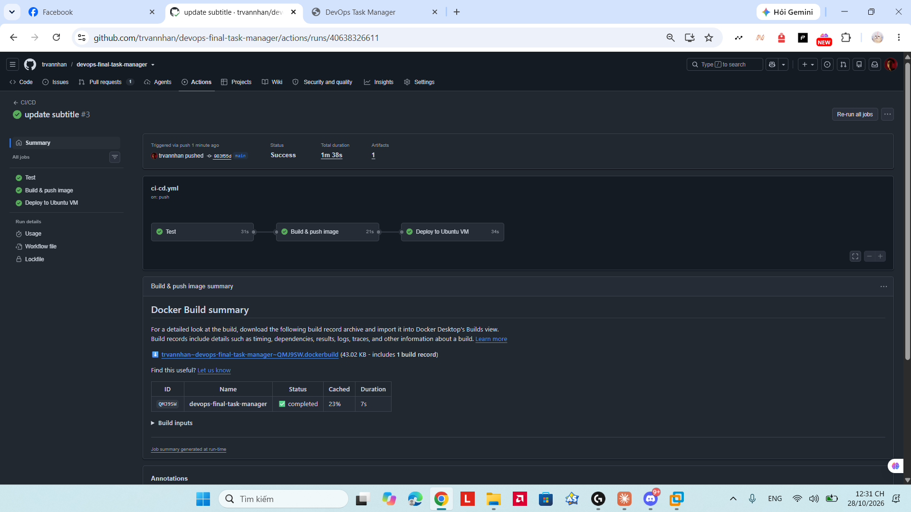
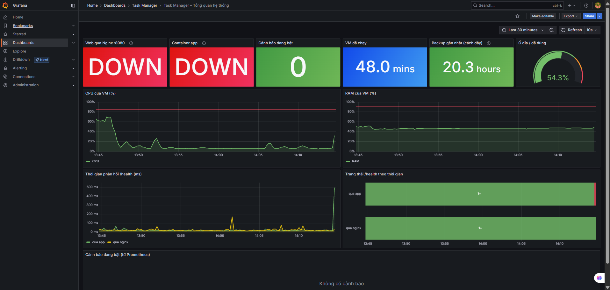
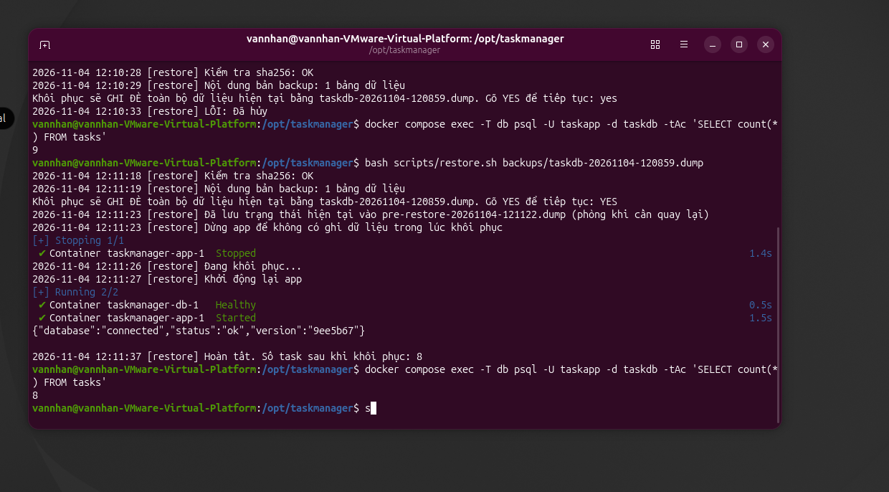

# Từ phát triển đến vận hành: Triển khai tự động và tin cậy ứng dụng Task Manager trên Ubuntu với Docker, GitHub Actions và Prometheus

**Môn học:** DevOps – Final Project 2026
**Nhóm thực hiện:** Trần Văn Nhân (23090036 – Nhóm trưởng) · Trần Văn Lực (23090019) · Nguyễn Vũ Hoàng Long (23090026)
**Repository:** https://github.com/trvannhan/devops-final-task-manager

---

## Tóm tắt (Abstract)

Báo cáo trình bày quá trình thiết kế, triển khai, tự động hóa, giám sát và vận hành ứng dụng web quản lý công việc (Task Manager) sử dụng Flask và PostgreSQL trên máy ảo Ubuntu 26.04.1 LTS trong khuôn khổ đồ án môn học DevOps (4 tuần). Hệ thống cung cấp giao diện web và REST API để tạo, xem, đánh dấu hoàn thành và xóa công việc, lưu dữ liệu bền vững trong PostgreSQL 18. Ứng dụng và cơ sở dữ liệu được đóng gói bằng Docker Compose phía sau reverse proxy Nginx ở cổng 8080. Quy trình CI/CD trên GitHub Actions gồm 3 job (`Test` → `Build & push image` → `Deploy to Ubuntu VM`), đẩy image gắn tag mã commit lên `ghcr.io` và triển khai xuống máy ảo qua self-hosted runner kết nối chủ động ra ngoài mạng NAT, kèm smoke test đối chiếu phiên bản trên `/health`. Hệ thống giám sát gồm Prometheus, Alertmanager, Grafana, node-exporter và blackbox-exporter theo dõi tài nguyên máy ảo và hai đường kiểm tra `/health` (qua Nginx và thẳng vào container app) với 7 luật cảnh báo được kiểm thử tự động bằng `promtool`. Về bảo mật, UFW chỉ mở cổng 22 và 8080, các cổng giám sát chỉ lắng nghe trên `127.0.0.1` truy cập qua SSH tunnel, secrets được nạp từ GitHub Secrets ra tệp `.env` quyền `600`, và ứng dụng kết nối database bằng role quyền tối thiểu `taskapp_rw` (bị từ chối khi thử `DROP TABLE`). Sao lưu hằng ngày lúc 02:00 bằng `pg_dump` kèm kiểm tra `sha256`, tích hợp cảnh báo `BackupTooOld` và kịch bản khôi phục an toàn đã được kiểm chứng thực tế.

**Từ khóa:** DevOps, CI/CD, Docker Compose, GitHub Actions, Self-hosted Runner, Prometheus, Grafana, PostgreSQL, Backup and Restore.

---

## 1. Giới thiệu

### 1.1. Bối cảnh, mục tiêu và phạm vi
Việc triển khai thủ công ứng dụng web lên máy chủ dễ dẫn đến sai lệch cấu hình giữa các lần cập nhật, thiếu khả năng phát hiện sớm khi dịch vụ ngưng hoạt động và rủi ro mất dữ liệu nếu không có quy trình sao lưu/khôi phục được kiểm chứng. Mục tiêu của đồ án là xây dựng một quy trình DevOps đầu-cuối (end-to-end) cho ứng dụng **Task Manager** (Flask + PostgreSQL), tập trung vào tự động hóa kiểm thử – triển khai, khả năng tái tạo môi trường từ máy sạch, giám sát chủ động, bảo mật theo nguyên tắc quyền tối thiểu và xử lý sự cố dựa trên playbook.

- **Phạm vi chức năng (`app/main.py`):** Cung cấp giao diện web tại `GET /` và các REST API: `GET /health` (thực thi `SELECT 1` kiểm tra kết nối PostgreSQL và trả về trường `version`), `GET /api/tasks`, `POST /api/tasks` (kiểm tra tiêu đề 1–200 ký tự, mô tả tối đa 1000 ký tự), `PATCH /api/tasks/<id>` và `DELETE /api/tasks/<id>`.
- **Môi trường máy chủ (`README.md`):** Máy ảo Ubuntu 26.04.1 LTS trên VMware Workstation (mạng NAT – VMnet8), cấu hình 2 vCPU, 4 GB RAM (dùng được 3.3 GiB), ổ đĩa 35 GB (`/dev/sda2`). Do cổng 80 trên cùng VM đang phục vụ một project khác của môn học (`devops-app`), Task Manager sử dụng cổng **8080**.
- **Công nghệ sử dụng:** Python (`Flask>=3.0,<4.0`, `gunicorn>=22,<26`, `psycopg[binary]>=3.1,<4.0`, `pytest>=8,<10`), PostgreSQL 18 (`postgres:18`), Nginx, UFW, Docker & Docker Compose v2, GitHub Actions + `ghcr.io`, Prometheus `v3.5.0`, Alertmanager `v0.28.1`, Grafana `12.0.0`, `node-exporter` `v1.9.1`, `blackbox-exporter` `v0.27.0`.
- **Nguồn code và việc sử dụng AI hỗ trợ:** Mã nguồn ứng dụng và một phần tài liệu/kịch bản được khởi tạo với sự hỗ trợ của trợ lý AI, sau đó nhóm trực tiếp rà soát, kiểm thử, thiết kế kiến trúc triển khai, cấu hình Ubuntu/Nginx/systemd/UFW/Docker/CI-CD/Monitoring, thực nghiệm trên máy ảo và xác minh toàn bộ kết quả. Dự án không sao chép template từ dự án bên thứ ba.

### 1.2. Lộ trình 4 tuần và phân công thành viên

*Bảng 1. Tóm tắt lộ trình 4 tuần thực hiện đồ án*

| Tuần | Nội dung chính | Minh chứng trong repository |
|---|---|---|
| **Week 1** | Cài đặt thủ công trên VM Ubuntu: venv, systemd (`taskmanager.service`), Nginx `:8080`, PostgreSQL trên host, UFW. | `evidence/01-os.png` → `08-tests.png` |
| **Week 2** | Đóng gói `Dockerfile`, `docker-compose.yml` (volume `pgdata`), CI/CD 3 job qua self-hosted runner, chuyển dữ liệu Week 1 vào container. | `evidence/week2/01` → `09` |
| **Week 3** | Giám sát Prometheus/Grafana/Alertmanager (7 luật cảnh báo), bảo mật (secrets, role `taskapp_rw`), backup/restore và playbook. | `evidence/week3/01` → `10` |
| **Week 4** | Hợp nhất hệ thống, viết `docs/deployment-guide.md` + `scripts/bootstrap-vm.sh` từ máy sạch, sơ đồ final, playbook 8 sự cố và báo cáo kỹ thuật. | `docs/`, `scripts/bootstrap-vm.sh` |

*Bảng 2. Phân công nhiệm vụ các thành viên (theo thống nhất trong `README.md`)*

| Thành viên | MSSV | Week 1 | Week 2–4 |
|---|---|---|---|
| **Trần Văn Nhân** *(nhóm trưởng)* | 23090036 | Máy ảo Ubuntu và SSH, Flask app/API, GitHub repository | Docker và Docker Compose; CI/CD GitHub Actions, self-hosted runner, smoke test; deployment guide và `bootstrap-vm.sh`; sơ đồ kiến trúc final; tổng hợp báo cáo; xử lý 3 sự cố thật |
| **Trần Văn Lực** | 23090019 | Firewall UFW, triển khai Nginx + systemd, sơ đồ kiến trúc | Prometheus, Grafana, Alertmanager, blackbox; 7 luật cảnh báo và `promtool`; checklist bảo mật; playbook mục 1, 4, 8 |
| **Nguyễn Vũ Hoàng Long** | 23090026 | Database PostgreSQL và CRUD, README, video demo | Chuyển dữ liệu Week 1 vào container; phân quyền `taskapp_rw`; backup/restore và cron; playbook mục 2, 3; README; minh chứng Week 4 và video |

---

## 2. Kiến trúc hệ thống

### 2.1. Sơ đồ kiến trúc hoàn chỉnh


*Hình 1. Sơ đồ kiến trúc hoàn chỉnh của hệ thống Task Manager (CI/CD, ứng dụng, phân tách mạng Docker, giám sát và sao lưu).*

### 2.2. Luồng xử lý yêu cầu và mô tả các thành phần
1. **Trình duyệt → UFW → Nginx (`:8080`):** Người dùng trên máy host Windows gửi yêu cầu tới `http://<VM_IP>:8080`. Tường lửa UFW chỉ mở cổng `22/tcp` và `8080/tcp`. Nginx chạy trên host Ubuntu nhận request và `proxy_pass` vào `http://127.0.0.1:8000` kèm các header `Host`, `X-Real-IP`, `X-Forwarded-For`, `X-Forwarded-Proto` (`scripts/nginx-taskmanager.conf`).
2. **Gunicorn/Flask (`container app`) → PostgreSQL (`container db`):** Container `app` lắng nghe tại `127.0.0.1:8000` trên host, chạy Gunicorn 2 worker dưới quyền user không phải root (`appuser`, UID 10001) và kết nối tới `db:5432` qua mạng nội bộ `backend` bằng role `taskapp_rw`.
3. **Lưu trữ bền vững (`volume pgdata`):** Container `db` (`postgres:18`) gắn volume `pgdata` vào `/var/lib/postgresql` và nạp `schema.sql` ở lần khởi tạo đầu tiên.
4. **Giám sát và sao lưu:** `blackbox-exporter` kiểm tra `/health` qua 2 đường (`via=nginx` và `via=app`); `node-exporter` thu thập chỉ số CPU, RAM, ổ đĩa của VM và đọc tệp chỉ số sao lưu `backups/metrics/backup.prom`; `prometheus` thu thập mỗi 15 giây, đánh giá 7 luật cảnh báo và đẩy sang `alertmanager`; `grafana` hiển thị dashboard. Lịch `cron` chạy `scripts/backup.sh` lúc 02:00 hằng ngày.

### 2.3. Bảng cổng dịch vụ và lý do chỉ mở `127.0.0.1` cho giám sát

*Bảng 3. Quy hoạch cổng trên máy ảo Ubuntu (`docs/security.md`)*

| Cổng | Dịch vụ | Lắng nghe trên | Mở trong UFW | Lý do thiết kế |
|---|---|---|---|---|
| `22` | SSH quản trị | Mọi interface | **Có** | Quản trị VM và tạo SSH tunnel để xem Grafana/Prometheus/Alertmanager. |
| `8080` | Nginx → Task Manager | Mọi interface | **Có** | Cổng duy nhất người dùng truy cập ứng dụng. |
| `80` | Nginx → `devops-app` | Mọi interface | Có | Thuộc project khác trên cùng VM, giữ nguyên không can thiệp. |
| `8000` | Container `app` (Gunicorn) | `127.0.0.1` | **Không** | Chỉ cho phép Nginx trên cùng máy ảo gọi vào. |
| `5432` | Container `db` (PostgreSQL) | Chỉ trong mạng `backend`, không publish ra host | **Không** | Chỉ container `app` truy cập qua mạng nội bộ Docker. |
| `9090` | Prometheus | `127.0.0.1` | **Không** | Không có xác thực mặc định; chỉ xem qua SSH tunnel. |
| `9093` | Alertmanager | `127.0.0.1` | **Không** | Không có xác thực mặc định; chỉ xem qua SSH tunnel. |
| `3000` | Grafana | `127.0.0.1` | **Không** | Không phơi trang đăng nhập ra mạng; xem qua SSH tunnel. |

---

## 3. Containerization

### 3.1. Thiết kế `Dockerfile`
Tệp `Dockerfile` sử dụng base image `python:3.14-slim` (single-stage build) với các lựa chọn kỹ thuật:
- **Không cần multi-stage build và tách biệt thư viện kiểm thử:** Ứng dụng chỉ cần 3 gói trong `requirements.txt` (`Flask`, `psycopg[binary]`, `gunicorn`) đều đã có wheel nhị phân dựng sẵn, không cần cài trình biên dịch C hay bước build frontend. Thư viện `pytest` được tách riêng sang `requirements-dev.txt` nên không đi vào image chạy thật, và `.dockerignore` loại bỏ `.git`, `.venv`, `tests`, `docs`, `evidence`.
- **Tận dụng cache layer:** `COPY requirements.txt .` và `RUN pip install -r requirements.txt` được đặt trước `COPY app ./app`, giúp chỉ phải cài lại thư viện khi `requirements.txt` thay đổi.
- **User không phải root & Healthcheck:** Tạo user `appuser` (`uid 10001`, `--no-create-home`) để chạy Gunicorn; truyền biến `ARG APP_VERSION` vào lúc build; cấu hình `HEALTHCHECK` mỗi 15 giây gọi `http://127.0.0.1:8000/health` bằng `urllib.request` của Python.

### 3.2. Thiết kế `docker-compose.yml` và chứng minh Persistence
- **Mạng và Volume:** Tách 2 mạng bridge `backend` (`app`, `db`) và `monitoring` (`app`, `prometheus`, `alertmanager`, `grafana`, `node-exporter`, `blackbox`), cùng 4 named volumes (`pgdata`, `prometheus-data`, `alertmanager-data`, `grafana-data`). Container `app` cấu hình `depends_on: db: condition: service_healthy` (chờ `pg_isready` thành công).
- **Logging và giới hạn RAM:** Cả 7 service dùng chung cấu hình `json-file` (`max-size: "10m"`, `max-file: "3"`) và `restart: unless-stopped`. Các container giám sát được giới hạn bộ nhớ (`mem_limit`: Prometheus `512m`, Grafana `256m`, Alertmanager `128m`, Node Exporter `64m`, Blackbox `64m`).
- **Chứng minh tính bền vững dữ liệu (`evidence/week2/02` và `04`):** Sau khi chuyển 7 công việc từ PostgreSQL trên host (Week 1) sang container bằng `scripts/migrate-host-db-to-docker.sh` và thêm công việc thứ 8 (`"Persistence test"`), nhóm chạy `docker compose down` để xóa hoàn toàn các container rồi chạy lại `docker compose up -d`. Volume `taskmanager_pgdata` vẫn được giữ lại và toàn bộ 8 bản ghi còn nguyên vẹn.

---

## 4. CI/CD Pipeline

### 4.1. Luồng 3 Job trong `.github/workflows/ci-cd.yml`
Workflow kích hoạt khi `push` lên `main`, khi mở `pull_request` vào `main`, hoặc chạy thủ công qua `workflow_dispatch`:
1. **Job `test` (`ubuntu-latest` + service container `postgres:18`):** Cài đặt `requirements-dev.txt` (có cache `pip`); chạy `python -m pytest -v` gồm **6 bài test** (3 unit test trong `tests/test_app.py` kiểm tra giao diện và dữ liệu đầu vào rỗng/sai kiểu; 3 integration test trong `tests/test_integration.py` kiểm tra `/health`, vòng đời CRUD và đối chiếu dữ liệu lưu trong PostgreSQL thật); kiểm tra `docker compose config --quiet`; chạy `promtool check config`, `promtool test rules alerts.test.yml`, `amtool check-config` và kiểm tra cú pháp JSON của dashboard Grafana. Với Pull Request, chỉ job `test` chạy; khi test lỗi, Build và Deploy bị chặn (`evidence/week2/08`, `09`).
2. **Job `build` (`ubuntu-latest`, chỉ chạy khi không phải PR và `test` đã xanh):** Lấy 7 ký tự đầu của `GITHUB_SHA` làm `APP_VERSION`, build image bằng Buildx (cache `type=gha`) và đẩy lên `ghcr.io/trvannhan/devops-final-task-manager` với hai tag `:<github.sha>` và `:latest`.
3. **Job `deploy` (`runs-on: [self-hosted, linux]`, `concurrency: deploy-vm`):** Chép `docker-compose.yml`, `schema.sql`, `monitoring/`, `scripts/` vào `/opt/taskmanager`; tạo thư mục `backups/metrics` và đặt `chmod 700 /opt/taskmanager/backups`, `chmod 755 /opt/taskmanager/backups/metrics`; kiểm tra đủ 3 GitHub Secrets rồi ghi `/opt/taskmanager/.env` với `umask 077`; kéo image mới, khởi động `db`, áp dụng `scripts/db-roles.sql`, chạy `docker compose up -d --no-build --remove-orphans`, cài cron backup `02:00`; cuối cùng chạy **smoke test** gọi `http://127.0.0.1:8080/health` tối đa 30 lần (60 giây) yêu cầu trả về đúng `"version":"<7 ký tự SHA>"` và kiểm tra `/-/ready` của Prometheus, Alertmanager cùng `/api/health` của Grafana.



*Hình 2. Minh chứng commit `983f55d` ("update subtitle") tự động kích hoạt pipeline 3 job và triển khai thành công trong 1m 38s.*

### 4.2. Lý do chọn Self-hosted Runner cho máy ảo sau NAT
Máy ảo Ubuntu chạy mạng **VMware NAT (VMnet8)** trên máy cá nhân nên không có địa chỉ IP công cộng; các runner của GitHub trên Internet không thể chủ động SSH vào VM. Việc cài đặt **self-hosted runner** thành dịch vụ systemd bên trong VM cho phép runner chủ động mở kết nối **HTTPS chiều đi ra** tới GitHub để nhận job deploy, không cần mở thêm cổng vào trên tường lửa hay lưu SSH private key của VM trên GitHub.

---

## 5. Giám sát, cảnh báo và tra cứu log

### 5.1. Stack giám sát và Dashboard Grafana (11 panel)
Prometheus thu thập số liệu mỗi 15 giây (`scrape_interval: 15s`, `evaluation_interval: 15s`, lưu 7 ngày) từ `node-exporter:9100` (CPU, RAM, ổ đĩa VM và tệp `backup.prom` qua `textfile collector`) và `blackbox:9115`. Module `http_health` của Blackbox (`monitoring/blackbox/blackbox.yml`) gửi HTTP GET với timeout 5 giây, yêu cầu mã `200` và thân phản hồi khớp biểu thức `"database":\s*"connected"` theo 2 đường:
- `via="nginx"` (`http://host.docker.internal:8080/health`): Đi qua Nginx trên host vào container `app`.
- `via="app"` (`http://app:8000/health`): Gọi thẳng container `app` trong mạng Docker.

Dashboard Grafana *"Task Manager – Tổng quan hệ thống"* (`monitoring/grafana/dashboards/taskmanager-overview.json`) được provision tự động gồm **11 panel**: 5 ô `stat` (*Web qua Nginx :8080*, *Container app*, *Cảnh báo đang bật*, *VM đã chạy*, *Backup gần nhất*), 1 ô `gauge` (*Ổ đĩa `/` đã dùng*), 3 biểu đồ `timeseries` (*CPU của VM (%)*, *RAM của VM (%)*, *Thời gian phản hồi `/health` (ms)*), 1 biểu đồ `state-timeline` (*Trạng thái `/health` theo thời gian*) và 1 bảng `table` (*Cảnh báo đang bật từ Prometheus*).

### 5.2. Bảy luật cảnh báo và kiểm thử bằng `promtool`

*Bảng 4. Bảy luật cảnh báo trong `monitoring/prometheus/alerts.yml`*

| Tên cảnh báo | Biểu thức (`expr`) | Ngưỡng `for` | Mức độ | Mô tả |
|---|---|---|---|---|
| `AppDownViaNginx` | `probe_success{job="health", via="nginx"} == 0` | `30s` | `critical` | `/health` qua Nginx `:8080` thất bại hơn 30 giây. |
| `AppContainerDown` | `probe_success{job="health", via="app"} == 0` | `30s` | `critical` | Gọi thẳng `http://app:8000/health` thất bại hơn 30 giây. |
| `HealthCheckSlow` | `probe_duration_seconds{job="health", via="nginx"} > 1` | `2m` | `warning` | `/health` phản hồi chậm hơn 1 giây trong 2 phút. |
| `HostHighCpu` | `100 * (1 - avg by (instance) (rate(node_cpu_seconds_total{mode="idle"}[2m]))) > 85` | `2m` | `warning` | CPU của VM trên 85% trong hơn 2 phút. |
| `HostHighMemory` | `100 * (1 - node_memory_MemAvailable_bytes / node_memory_MemTotal_bytes) > 90` | `2m` | `warning` | RAM của VM trên 90% trong hơn 2 phút. |
| `HostDiskAlmostFull` | Tỷ lệ dung lượng đã dùng của `/` (`fstype!~"tmpfs\|overlay"`) > `85` | `5m` | `warning` | Ổ đĩa `/` của VM đã dùng trên 85% trong 5 phút. |
| `BackupTooOld` | `time() - taskmanager_backup_last_success_timestamp_seconds > 26 * 3600` | `10m` | `warning` | Chưa có backup thành công trong 26 giờ. |

- **Kiểm thử bằng `promtool`:** Tệp `monitoring/prometheus/alerts.test.yml` kiểm thử tự động trong CI 4 trường hợp: (1) app chết liên tục → `eval_time: 30s` chưa bắn, `eval_time: 75s` bật `AppContainerDown`; (2) lỗi chớp nhoáng 15s → không báo `AppDownViaNginx`; (3) backup cũ hơn 26h → bật `BackupTooOld` ở `20m`; (4) backup mới chạy → không báo.
- **Inhibit rule và thời gian phát hiện sự cố:** Alertmanager cấu hình `inhibit_rules` ẩn `AppDownViaNginx` khi `AppContainerDown` đang bật. Về thời gian phát hiện: lý thuyết cấu hình trong README/playbook là khoảng 30–45 giây sau khi dừng app (`scrape_interval: 15s` + `for: 30s`, thêm `group_wait: 10s` trước khi hiển thị trên Alertmanager); trong các lần đo thực tế từ lúc dừng container đến khi cảnh báo hiển thị đầy đủ ghi nhận trong khoảng **45–80 giây** tùy thời điểm rơi vào chu kỳ scrape và đánh giá luật.



*Hình 3. Dashboard Grafana trong lúc diễn ra sự cố (biểu đồ trạng thái `/health` chuyển đỏ) và sau khi khôi phục.*

### 5.3. Cách tra cứu nhật ký ứng dụng theo thời gian
Gunicorn ghi access log (`--access-logfile -`) và log lỗi của Flask ra stdout, được Docker lưu bằng `json-file` driver. Các lệnh tra cứu theo thời gian và lọc lỗi (`README.md`):
```bash
cd /opt/taskmanager
docker compose logs --timestamps --since 30m app                      # 30 phút gần nhất
docker compose logs --timestamps --since 2026-11-05T14:00:00 --until 2026-11-05T14:15:00 app
docker compose logs --since 1h app | grep -E '" (4|5)[0-9]{2} '       # chỉ request lỗi 4xx/5xx
docker compose logs --since 1h app | grep -iE 'error|exception'        # lỗi của ứng dụng
sudo tail -n 50 /var/log/nginx/error.log                              # lỗi phía Nginx
```

---

## 6. Bảo mật

1. **Firewall và cô lập mạng (`docs/security.md`):** UFW đặt `default deny incoming`, chỉ mở cổng `22` và `8080` (cổng `80` của project khác). Container `db` chỉ nằm trong mạng `backend`, không publish cổng 5432, nên cả mạng ngoài lẫn các container trong mạng `monitoring` đều không thể kết nối trực tiếp vào database.
2. **Quản lý Secrets:** Ba secret (`POSTGRES_PASSWORD`, `APP_DB_PASSWORD`, `GRAFANA_ADMIN_PASSWORD`) lưu trong GitHub Secrets, không có trong mã nguồn hay lịch sử Git. Khi deploy, runner dùng `umask 077` tạo `/opt/taskmanager/.env` (quyền `600`, chỉ user `vannhan` đọc được).
3. **Phân quyền hai role Database (`scripts/db-roles.sql`):**
   - `taskapp`: Chủ sở hữu database `taskdb`, chỉ dùng khi tạo bảng, chạy `backup.sh` và `restore.sh`.
   - `taskapp_rw`: Role mà container `app` sử dụng (`NOSUPERUSER NOCREATEDB NOCREATEROLE`), thu hồi quyền `CREATE` trên schema `public` và chỉ cấp `SELECT, INSERT, UPDATE, DELETE` trên bảng `tasks` cùng `USAGE, SELECT` trên `tasks_id_seq`.
   - **Kiểm chứng thực tế:** Khi kết nối bằng `taskapp_rw` và chạy `DROP TABLE tasks`, PostgreSQL từ chối với lỗi `ERROR: must be owner of table tasks`.
4. **Gia cố Container (Container Hardening):** Container `app` chạy bằng user `appuser` (uid 10001); các phiên bản image đều được cố định; toàn bộ thư mục cấu hình giám sát và `schema.sql` được mount ở chế độ chỉ đọc (`:ro`); Grafana tắt đăng ký (`GF_USERS_ALLOW_SIGN_UP: "false"`) và tắt truy cập ẩn danh (`GF_AUTH_ANONYMOUS_ENABLED: "false"`).

---

## 7. Backup và Restore

### 7.1. Chiến lược sao lưu (`scripts/backup.sh`) và tích hợp giám sát
- **Lịch chạy và kiểm tra toàn vẹn:** Cron chạy `backup.sh` lúc `02:00` mỗi ngày. Script đặt `umask 077` (các tệp tạo ra có quyền `600`, trong khi quyền `700` trên thư mục `/opt/taskmanager/backups` được đặt bởi bước `chmod 700 "$DEPLOY_DIR/backups"` trong `.github/workflows/ci-cd.yml`), chạy `pg_dump -U taskapp -d taskdb --format=custom` ra tệp tạm `.part`, kiểm tra đọc được bằng `pg_restore --list` rồi đổi tên thành `taskdb-YYYYMMDD-HHMMSS.dump` và ghi mã băm `sha256sum "$file" > "$file.sha256"`.
- **Lưu giữ 7 ngày:** Xóa các tệp `taskdb-*.dump*` và `pre-restore-*.dump` có thời gian sửa đổi hơn 7 ngày (`find ... -mtime +7 -print -delete`).
- **Tích hợp cảnh báo `BackupTooOld`:** Cuối mỗi lần chạy thành công, script ghi 3 chỉ số (`taskmanager_backup_last_success_timestamp_seconds`, `taskmanager_backup_last_size_bytes`, `taskmanager_backup_last_rows`) vào `backups/metrics/backup.prom` để `node-exporter` thu thập và Prometheus cảnh báo nếu quá 26 giờ chưa có bản sao lưu mới.

### 7.2. Quy trình khôi phục (`scripts/restore.sh`) và kết quả kiểm chứng
Script `restore.sh` thực hiện đúng các bước sau:
1. Kiểm tra toàn vẹn tệp bằng `sha256sum --check --quiet "$file.sha256"` và đếm số bảng dữ liệu qua `pg_restore --list`.
2. Hỏi xác nhận bắt buộc gõ đúng chữ `YES` (trừ khi truyền cờ `--yes`).
3. Tự động lưu trạng thái hiện tại của database vào `pre-restore-YYYYMMDD-HHMMSS.dump` (với `umask 077`) để phòng khi cần quay lại.
4. Dừng container `app` (`docker compose stop app`, kèm `trap` tự bật lại app khi script thoát).
5. Chạy `pg_restore -U taskapp -d taskdb --clean --if-exists --single-transaction --exit-on-error < "$file"`. *(Lưu ý: `restore.sh` không gọi lại `db-roles.sql` mà chính tệp custom dump do `pg_dump` xuất ra đã lưu kèm các câu lệnh `GRANT` ACL của bảng `tasks` cho `taskapp_rw`, nên khi `pg_restore` khôi phục trong 1 transaction sẽ khôi phục luôn các quyền này).*
6. Khởi động lại container `app` (`docker compose start app`), chờ `/health` qua cổng 8080 trả về thành công và đếm lại `SELECT count(*) FROM tasks`.

**Kết quả thử nghiệm thực tế ngày 04/11/2026 (`evidence/week3/09` và `10`):**
- Lúc `12:08:59`, chạy `bash scripts/backup.sh` khi DB có **8 task** → hoàn tất lúc `12:09:02` (3 giây), tạo tệp `taskdb-20261104-120859.dump` (**4040 bytes**, 8 task).
- Thêm công việc thử nghiệm `"Test restore"` (`id=9`) qua `POST /api/tasks` → `SELECT count(*) FROM tasks` trả về **9**.
- Chạy `restore.sh`: lần đầu gõ `yes` thường bị hủy (`LỖI: Đã hủy`); lần hai chạy lúc `12:11:18`, gõ `YES` lúc `12:11:23` → lưu bản `pre-restore-20261104-121122.dump`, dừng app, `pg_restore`, bật lại app, `/health` trả `{"database":"connected","status":"ok","version":"9ee5b67"}` và hoàn tất lúc `12:11:37` (14 giây từ lúc xác nhận). Đếm lại `SELECT count(*) FROM tasks` trả về đúng **8**, task `"Test restore"` đã biến mất.



*Hình 4. Nhật ký thực thi `restore.sh` kiểm tra sha256, tạo bản pre-restore và khôi phục về đúng 8 task.*

---

## 8. Xử lý sự cố (Troubleshooting)

### 8.1. Phương pháp khoanh vùng và 8 kịch bản trong `docs/playbook.md`
Playbook (`docs/playbook.md`) gồm **8 mục sự cố** (mục 1–4 và 8 là thực nghiệm bao phủ đủ 5 tình huống giảng viên có thể chọn ở Week 4; mục 5–7 là 3 sự cố đã xảy ra thật), mỗi mục đều theo cấu trúc: **triệu chứng → xác minh → nguyên nhân → khắc phục → phòng tránh**. Khi có sự cố, nhóm mở Grafana xem ô nào báo đỏ rồi chạy 2 lệnh `curl` tới `/health` (qua Nginx `:8080` và thẳng vào app `:8000`) để khoanh vùng nhanh:

*Bảng 5. Bảng khoanh vùng nhanh nguyên nhân sự cố (`docs/playbook.md`)*

| Qua Nginx (`:8080`) | Thẳng app (`:8000`) | Ý nghĩa chẩn đoán | Xem mục Playbook |
|---|---|---|---|
| `200` | `200` | Hệ thống trong VM bình thường (nếu từ Windows không vào được là do firewall/mạng) | Mục 8 |
| `502` | `000` (không kết nối được) | Container `app` dừng | Mục 1 |
| `503` | `503` | App chạy nhưng mất kết nối hoặc lỗi xác thực database | Mục 2, 3 |
| `502` / `404` | `200` | App bình thường, lỗi cấu hình ở Nginx | Mục 4 |
| `000` (Nginx dừng) | `200` | Dịch vụ Nginx trên host không chạy | Mục 4, 8 |

### 8.2. Ba sự cố thật đã xảy ra và tình huống lỗi mật khẩu DB ngày 04/11

*Bảng 6. Tóm tắt các sự cố thực tế của nhóm và bài học rút ra*

| Sự cố & Thời điểm | Triệu chứng & Nguyên nhân gốc | Cách khắc phục & Phòng tránh |
|---|---|---|
| **1. SSH bị từ chối kết nối**<br>*(27/10/2026 – Mục 6 Playbook)* | `ssh vannhan@<VM_IP>` báo `port 22: Connection refused`; `ss -lntp` không có cổng 22 do bản Ubuntu Desktop không cài sẵn `openssh-server`. | Cài `openssh-server`, `systemctl enable --now ssh`, `ufw allow OpenSSH`. **Bài học:** Phân biệt *Connection refused* (không có dịch vụ) với *timeout* (bị chặn); đưa `openssh-server` vào bước cài đặt ban đầu và `bootstrap-vm.sh`. |
| **2. Job Deploy đứng ở Queued**<br>*(27–28/10/2026 – Mục 7 Playbook)* | Job `Test` và `Build` xanh nhưng `Deploy to Ubuntu VM` đứng ở *Queued* lâu do chưa cài runner (27/10) hoặc VM/laptop đang tắt nên runner *Offline*. | Bật VM và cài runner dạng service (`sudo ./svc.sh install vannhan && sudo ./svc.sh start`). **Bài học:** Runner phải chạy dạng service tự khởi động cùng VM; luôn kiểm tra trạng thái *Idle* trước buổi demo. |
| **3. Deploy thất bại vì thiếu Secret**<br>*(28/10/2026 – Mục 5 Playbook)* | Job `Deploy` đỏ ở bước `Write .env from GitHub Secrets`. Nguyên nhân: job được xếp hàng từ tối 27/10 trước khi tạo secret `POSTGRES_PASSWORD`; GitHub đóng gói dữ liệu lúc xếp hàng nên giá trị secret trong job đó vẫn rỗng dù sau đó đã tạo. | Tạo đủ secret rồi bấm **Re-run failed jobs** (đã xử lý lúc 11:50 ngày 28/10). **Bài học:** Thêm vòng lặp kiểm tra báo lỗi rõ tên secret bị thiếu và liệt kê đủ các secret cần tạo trước trong README / deployment guide. |
| **4. Lỗi xác thực mật khẩu `taskapp_rw`**<br>*(04/11/2026 – `evidence/week3/README.md` & Mục 3 Playbook)* | Trong khoảng sự cố ghi lại ở ảnh `05`, `06` ngày 04/11, `/health` trả `503` và log app báo `password authentication failed for user "taskapp_rw"` do mật khẩu của role `taskapp_rw` trong PostgreSQL và giá trị `APP_DB_PASSWORD` trong `.env` không khớp nhau (nguyên nhân dẫn tới việc hai giá trị bị lệch thời điểm đó không được ghi log lại nên không khẳng định chắc chắn là do thao tác tay hay thứ tự chạy trước đó). | Đặt lại mật khẩu role `taskapp_rw` theo giá trị trong `.env` bằng lệnh `docker compose exec -T db psql -U taskapp -d taskdb -v app_password="$APP_PW" < scripts/db-roles.sql` rồi `docker compose restart app` (commit `3248be8`). **Bài học:** Pipeline chạy `db-roles.sql` ở mỗi lần deploy để luôn đồng bộ mật khẩu role với `.env`. |

---

## 9. Đánh giá và hạn chế

### 9.1. Tổng hợp số liệu kiểm chứng và những điểm đã làm tốt

*Bảng 7. Các số liệu đã kiểm chứng từ repository và ảnh minh chứng (`evidence/`)*

| Hạng mục | Giá trị kiểm chứng | Nguồn xác minh trong repository |
|---|---|---|
| **Thời gian chạy toàn bộ pipeline CI/CD** | **1m 19s** (commit `1b21dc9`: Test `29s`, Build `38s`, Deploy `1m 11s` khi re-run)<br>**1m 38s** (commit `983f55d`: Test `31s`, Build `21s`, Deploy `34s`) | Ảnh chụp GitHub Actions `evidence/week2/05-pipeline-green.png` và `06-commit-pipeline-green.png`. |
| **Thời gian bước Docker Build (Buildx)** | **19s** (`0%` cached – commit `1b21dc9`) / **7s** (`23%` cached – commit `983f55d`) | Bảng *Docker Build summary* trong `evidence/week2/05` và `06`. |
| **Số bài kiểm thử tự động trong CI** | **6 bài pytest** (3 unit + 3 PostgreSQL integration) + **4 kịch bản `promtool test rules`** | `tests/test_app.py`, `tests/test_integration.py`, `monitoring/prometheus/alerts.test.yml`, `evidence/week2/09`. |
| **Thời gian cảnh báo bật khi dừng app** | Cấu hình: `scrape_interval 15s` + `for: 30s` (lý thuyết 30–45s); các lần đo thực tế: **45–80 giây** | `monitoring/prometheus/prometheus.yml`, `alerts.yml`, thực nghiệm của nhóm. |
| **Thời gian sao lưu & kích thước bản backup** | **3 giây** (`12:08:59` → `12:09:02`) · **4040 bytes** (cho **8 task**) | Ảnh terminal `evidence/week3/09-backup-va-cron.png`. |
| **Thời gian chạy `restore.sh` hoàn chỉnh** | **14 giây** từ lúc gõ `YES` (`12:11:23` → `12:11:37`, khôi phục từ 9 task về **8 task**) | Ảnh terminal `evidence/week3/10-restore-thanh-cong.png`. |

**Những điểm hệ thống đã làm tốt:**
- Quy trình CI/CD khép kín từ commit tới production, kiểm tra tự động cả code Python (với PostgreSQL thật) lẫn cấu hình Compose, Prometheus, luật cảnh báo (`promtool`) và Alertmanager (`amtool`), kèm smoke test đối chiếu đúng mã commit.
- Giám sát hai đường (`via=nginx` và `via=app`) kết hợp `inhibit_rules` giúp phân biệt ngay lỗi ở tầng proxy hay tầng ứng dụng; tích hợp chỉ số sao lưu vào Prometheus để cảnh báo `BackupTooOld`.
- Bảo mật nhiều lớp (UFW, cô lập 2 mạng Docker, chỉ lắng nghe `127.0.0.1` + SSH tunnel, `.env` quyền `600`, role `taskapp_rw` chỉ có quyền DML).

### 9.2. Hạn chế hiện tại và hướng phát triển
1. **Chưa có HTTPS (TLS):** Nginx `:8080` hiện chạy HTTP thuần vì VM dùng IP riêng trong mạng NAT, chưa có tên miền công cộng hay chứng chỉ TLS (`docs/security.md`).
2. **Bản sao lưu chưa được chép ra ngoài VM (Off-site backup):** Thư mục `/opt/taskmanager/backups/` nằm trên ổ đĩa của cùng máy ảo; nếu hỏng cả VM sẽ mất cả bản sao lưu (`README.md`, `docs/security.md`).
3. **Chưa sử dụng Connection Pool cho cơ sở dữ liệu:** Hàm `db()` trong `app/main.py` gọi `psycopg.connect(url)` tạo kết nối mới cho mỗi request (bao gồm cả các lượt probe `/health` mỗi 15 giây) thay vì tái sử dụng kết nối qua `psycopg_pool`.
4. **SSH chưa khóa xác thực mật khẩu (SSH key-only):** Dịch vụ SSH trên VM chưa đặt `PasswordAuthentication no` và chưa giới hạn IP được phép SSH (`docs/security.md`).
5. **Điểm mù giám sát từ bên ngoài và kênh thông báo:** `blackbox-exporter` chạy trong VM nên không phát hiện được trường hợp UFW chặn cổng 8080 từ phía Windows (đã bổ sung hướng dẫn kiểm tra tại mục 8 của `docs/playbook.md`); receiver `web-ui` của Alertmanager hiện chỉ hiển thị trên giao diện web, chưa gửi thông báo qua Telegram/Discord/Email.

**Hướng phát triển:** Bổ sung chứng chỉ TLS cho Nginx; cấu hình `PasswordAuthentication no` cho SSH; tự động `scp`/đẩy bản sao lưu ra ngoài VM; dùng `psycopg_pool.ConnectionPool`; cấu hình receiver Alertmanager gửi thông báo Telegram/Email; thêm bước quét lỗ hổng image (Trivy) và tự động rollback khi smoke test thất bại.

---

## 10. Kết luận và Tài liệu tham khảo

### 10.1. Kết luận và bài học DevOps rút ra sau 4 tuần
Qua 4 tuần thực hiện đồ án, nhóm đã hoàn thiện chuỗi triển khai và vận hành tự động cho ứng dụng Task Manager từ cài đặt thủ công (Week 1) lên kiến trúc container hóa có CI/CD (Week 2), giám sát – bảo mật – sao lưu (Week 3) và tài liệu hóa tái tạo từ máy sạch kèm xử lý sự cố (Week 4).

**Bốn bài học thực tế rút ra:**
1. **Deploy thành công phải được xác minh bằng Smoke Test:** Chỉ chạy `docker compose up -d` là chưa đủ; việc nhúng mã commit vào `APP_VERSION` và kiểm tra `/health` trả về đúng version mới đảm bảo container mới thực sự đang chạy và kết nối được tới database.
2. **Mọi bước cấu hình cần có tính lũy đẳng (Idempotent):** Từ việc tạo role database (`db-roles.sql`), cài đặt lịch `cron`, ghi tệp `.env` đến script chuẩn bị máy chủ (`bootstrap-vm.sh`) đều cần chạy lại được nhiều lần mà không gây lỗi, giúp tránh lệch trạng thái giữa các lần cập nhật.
3. **Thiết kế giám sát gắn liền với Playbook:** Hai mũi thăm dò `via=nginx` và `via=app` cho phép ánh xạ trực tiếp triệu chứng trên dashboard sang bảng khoanh vùng trong playbook, rút ngắn thời gian tìm nguyên nhân gốc.
4. **Kiểm thử cả cấu hình vận hành và quy trình khôi phục:** Việc đưa `promtool test rules` vào CI và trực tiếp diễn tập `restore.sh` trên dữ liệu thử nghiệm giúp đảm bảo hệ thống cảnh báo và bản sao lưu thực sự dùng được khi xảy ra sự cố.

### 10.2. Tài liệu tham khảo
1. Docker Inc., *Dockerfile Reference & Compose File Reference*, https://docs.docker.com/
2. GitHub, *GitHub Actions Documentation & About Self-hosted Runners*, https://docs.github.com/en/actions
3. Prometheus Authors, *Prometheus Configuration, Alerting Rules & Unit Testing for Rules*, https://prometheus.io/docs/
4. Prometheus Authors, *Blackbox Exporter & Node Exporter*, https://github.com/prometheus
5. Grafana Labs, *Grafana Provisioning Documentation*, https://grafana.com/docs/
6. PostgreSQL Global Development Group, *PostgreSQL 18 Documentation: Database Roles, `pg_dump`, `pg_restore`*, https://www.postgresql.org/docs/18/
7. Nginx Inc., *Module `ngx_http_proxy_module`*, https://nginx.org/en/docs/
8. Canonical Ltd., *Ubuntu Server Guide: Uncomplicated Firewall (UFW)*, https://documentation.ubuntu.com/
